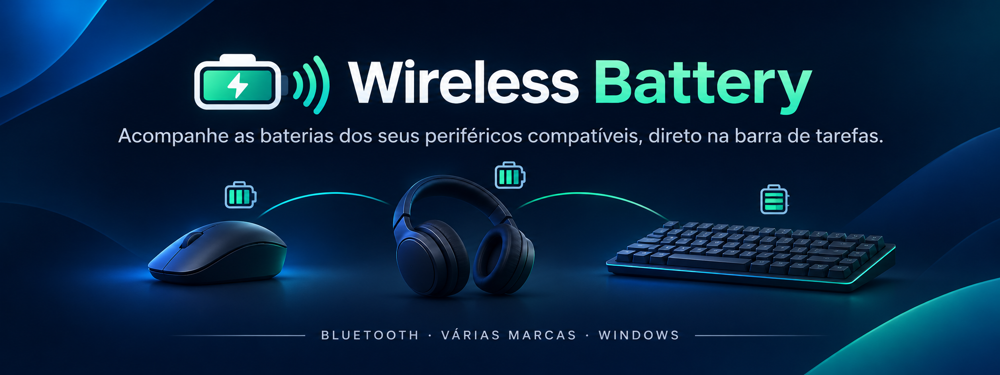

  

   

  
  
  

  
<strong>Acompanhe as baterias dos seus periféricos compatíveis, direto na barra de tarefas.</strong>

## ✨ O que ele faz

- Acompanha e exibe a bateria dos periféricos em uma faixa compacta na barra de tarefas.
- Monitora dispositivos Bluetooth de várias marcas quando o Windows informa o nível da bateria.
- Permite personalizar cores, fundo, ícones, nomes e quais dispositivos aparecem.
- Também lê alguns periféricos por cabo, receptor ou dock USB, conforme o suporte de cada modelo.

## ⬇️ Instalação

1. [Baixe o instalador](https://github.com/SRdorki/wireless-battery/raw/refs/heads/main/WirelessBatterySetup.exe).
2. Execute `WirelessBatterySetup.exe` e clique em **Instalar**.
3. Deixe marcada a opção **Iniciar automaticamente com o Windows** para manter a faixa após entrar no sistema.

O instalador é por usuário e coloca o aplicativo em `%LOCALAPPDATA%\Programs\Wireless Battery`.

## 🔄 Atualizações automáticas

O app consulta [`latest.json`](latest.json) ao iniciar e a cada seis horas. Quando há uma versão mais recente, baixa o pacote, confere o SHA-256 e reinicia com a atualização aplicada.

Os downloads ficam na branch `main`, na raiz do repositório. Para atualizar, publique o novo instalador, o pacote ZIP, o checksum e ajuste a versão e os links em `latest.json`.

## 📦 Arquivos

| Arquivo | Para que serve |
| --- | --- |
| [WirelessBatterySetup.exe](WirelessBatterySetup.exe) | Instalar ou remover o aplicativo |
| [Baterias-dos-perifericos.zip](Baterias-dos-perifericos.zip) | Pacote aplicado pelo atualizador |
| [Baterias-dos-perifericos.zip.sha256](Baterias-dos-perifericos.zip.sha256) | Conferir a integridade do pacote |
| [latest.json](latest.json) | Informar a versão e os endereços dos arquivos |

## ℹ️ Compatibilidade

O suporte Bluetooth funciona com várias marcas, desde que o periférico exponha a bateria ao Windows ou use o serviço Bluetooth padrão de bateria. Alguns dispositivos não disponibilizam essa informação.

Receptores, docks e cabos USB podem usar protocolos diferentes. Esta versão inclui suporte para um perfil de receptor USB verificado; outros modelos USB podem exigir suporte específico.

## 🔒 Privacidade

As leituras dos periféricos são feitas localmente. A conexão à internet é usada para consultar o feed público e baixar atualizações; o app não envia dados de uso.
